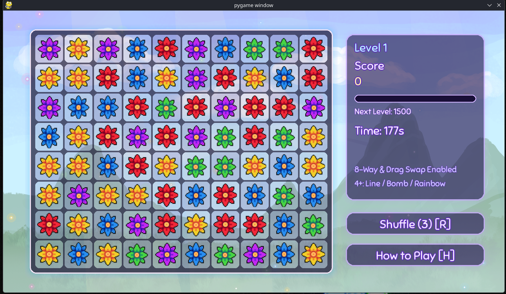

# 🌸 Flowers

**Flowers** is a fast-paced, vibrant arcade match-3 puzzle game where you swap colorful blossoms, trigger dazzling chain reactions, and race against the clock to climb the leaderboard!



---

## ✨ Features

* **8-Direction Freedom (Including Diagonals!):** Unlike traditional match-3 games that lock you into 4 directions, **Flowers** lets you swap neighboring blooms horizontally, vertically, *or diagonally*—using either quick click-and-drag gestures or classic two-click selection.
* **Cascading Combos & Gravity:** Watch blossoms tumble into place as cleared rows trigger chain reactions that multiply your score (`2x`, `3x`, and beyond!).
* **Explosive Power-Up Blooms:**
  * ⚡ **Zap Flower (4-Match):** Sweeps across the board to clear its entire row and column!
  * 🌈 **Rainbow Flower (5-Match):** Clears every flower of its color across the entire board at once!
  * 💥 **Bloom Bomb (6+ or L/T-Match):** Detonates a **5×5** petal blast around itself!
* **Level Progression & Time Bonuses:** Fill your level progress bar to advance to higher levels and earn **+25s** time extensions to keep your run alive.
* **Custom Visual Shaders & Particle Effects:** Enjoy glowing neon board borders, animated sunbeams, drifting pollen particles, shimmering selection auras, and petal-burst explosions.
* **Smart Hints, Board Shuffles & High Scores:** Stuck on a tricky board? Wait 6 seconds for an automatic wiggle hint, hit **Shuffle (`R`)** for a fresh layout, and compete to beat your **Top 5 High Scores**!

---

## 🎮 How to Play & Controls

| Action | Control |
| :--- | :--- |
| **Start Game / Dismiss Menu** | Left Click or `Space` |
| **Swap Flowers (8-Way)** | Click 2 adjacent/diagonal flowers **or** Click & Drag |
| **Shuffle Board** | Click **Shuffle** button or press `R` |
| **Open / Close How to Play Guide** | Click **How to Play** button or press `H` |
| **Quit (from End Screen)** | `ESC` |

---

## 🚀 Installation & Running

### Requirements
* **Python 3** and **pip**

### Setup
1. Clone the repository and navigate into the project folder:
   ```bash
   git clone https://github.com/Frankmau5/flowers.git
   cd flowers
   ```
2. Install the required dependencies:
   ```bash
   pip install -r requirements.txt
   ```
3. Launch the game:
   ```bash
   python3 main.py
   ```

---

## 📄 License
GPLv3 — [Read the license here](https://github.com/Frankmau5/flowers/blob/main/LICENSE)
