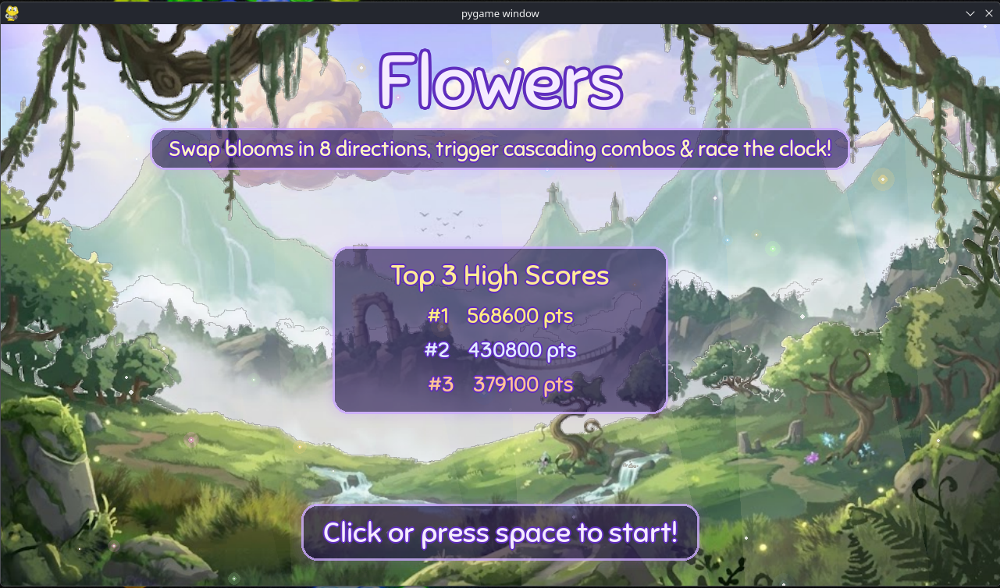
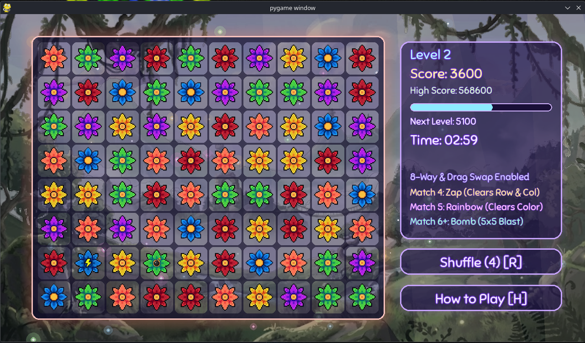
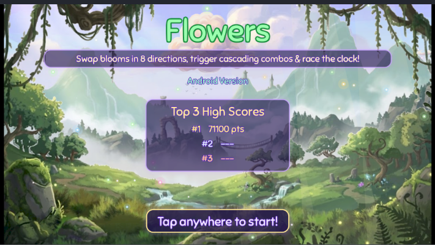

# 🌸 Flowers

**Flowers** is a fast-paced, vibrant arcade match-3 puzzle game where you swap colorful blossoms in 8 directions, trigger dazzling chain reactions, and race against the clock to climb the leaderboard—available on **Desktop (Python / Pygame-CE)** and **Android (Kotlin)**!

## 📸 Screenshots

### Desktop — Main Menu & Gameplay




### Android Version


---

## ✨ Features

* **8-Direction Freedom (Including Diagonals!):** Unlike traditional match-3 games that lock you into 4 directions, **Flowers** lets you swap neighboring blooms horizontally, vertically, *or diagonally*—using either quick click/touch-and-drag gestures or classic two-tap selection.
* **Cascading Combos & Gravity:** Watch blossoms tumble into place as cleared rows trigger chain reactions that multiply your score (`2x`, `3x`, and beyond!).
* **Explosive Power-Up Blooms & Shaders:**
  * ⚡ **Zap Flower (4-Match):** Fires crackling electric lightning beams across the board to clear its entire row and column!
  * 🌈 **Rainbow Flower (5-Match):** Radiates a prismatic shockwave and shoots rainbow laser beams to clear every flower of its color across the board (**+3s** bonus time)!
  * 💥 **Bloom Bomb (6+ Match):** Detonates a fiery **5×5** shockwave blast around itself with board impact shake (**+3s** bonus time)!
* **Level Progression & Time Bonuses:** Fill your level progress bar to advance to higher levels, earn **+15s** time extensions, and gain extra board shuffles to keep your run alive.
* **Parallax Worlds, Custom Shaders & Synthesized Audio:** Enjoy multi-layer parallax landscapes with drifting clouds, animated sunbeams, floating pollen particles, glowing neon borders, and procedural arcade sound effects.
* **Smart Hints, Board Shuffles & High Scores:** Stuck on a tricky board? Wait 6 seconds for an automatic wiggle hint, hit **Shuffle (`R`)** for a fresh layout, and compete to beat your **Top 5 High Scores**!
* **Native Android Version Included:** Includes a full 60 FPS native Kotlin Android port in [`android/`](android/) that shares the exact same `imgs/` and `fonts/` assets.

---

## 🎮 How to Play & Controls

| Action | Desktop Control | Android Control |
| :--- | :--- | :--- |
| **Start Game / Dismiss Modal** | Left Click or `Space` | Tap anywhere |
| **Swap Flowers (8-Way)** | Click 2 neighbors **or** Click & Drag | Tap 2 neighbors **or** Touch & Drag |
| **Shuffle Board** | Click **Shuffle** button or press `R` | Tap **Shuffle** button |
| **Open / Close How to Play Guide** | Click **How to Play** button or press `H` | Tap **How to Play** button |
| **Quit (from End Screen)** | `ESC` | System Back / Home |

---

## 🚀 Installation & Running

### 🖥️ Desktop (Python 3)

1. Clone the repository and navigate into the project folder:
   ```bash
   git clone https://github.com/Frankmau5/flowers.git
   cd flowers
   ```
2. Install the required dependencies:
   ```bash
   pip install -r requirements.txt
   ```
3. Launch the game:
   ```bash
   python3 main.py
   ```

### 🤖 Android (Kotlin / Gradle)

The native Android project lives in [`android/`](android/) and automatically packages the shared `imgs/` and `fonts/` folders during build:

```bash
gradle -p android assembleDebug
adb install -r android/app/build/outputs/apk/debug/app-debug.apk
```

---

## 👤 Author & Links

* **Made by Frank Mulvie** — [https://knrf.itch.io/](https://knrf.itch.io/)

## 📄 License
GPLv3 — [Read the license here](https://github.com/Frankmau5/flowers/blob/main/LICENSE)
